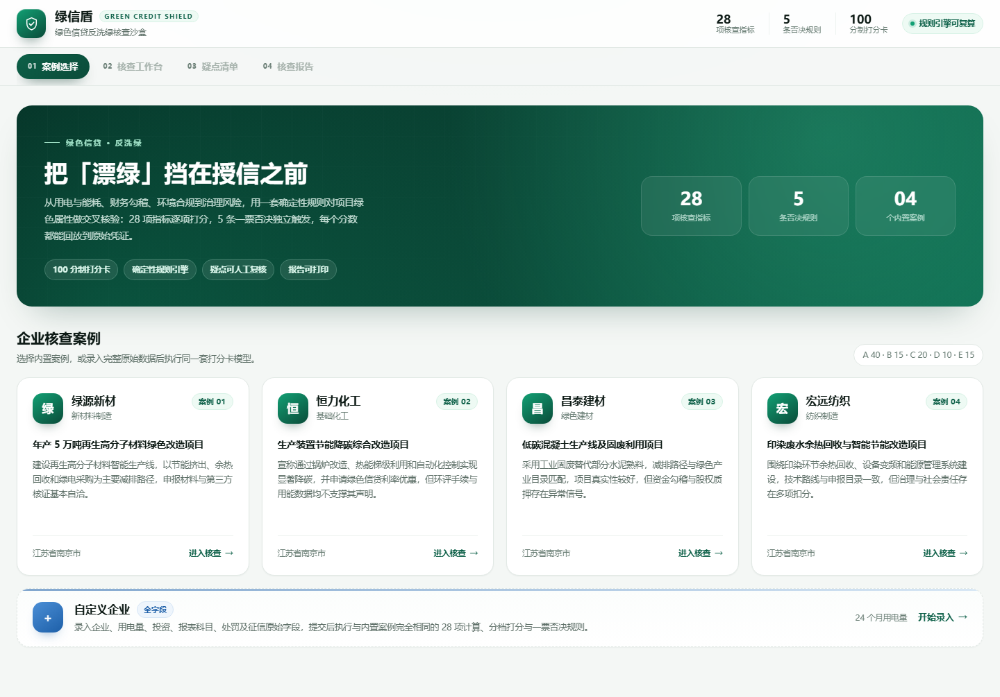
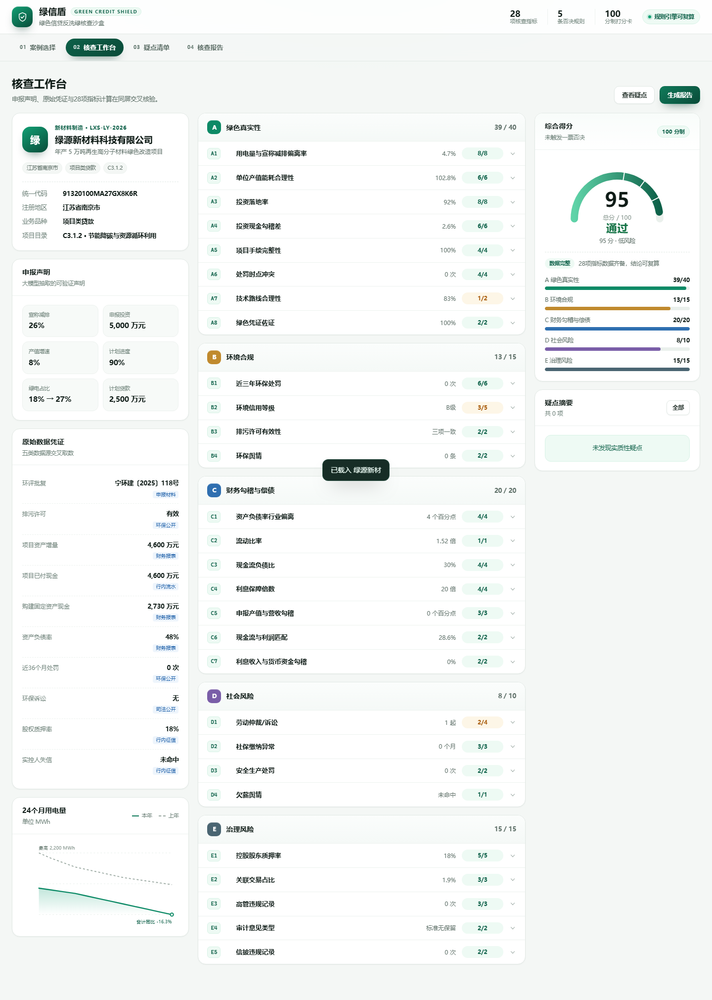
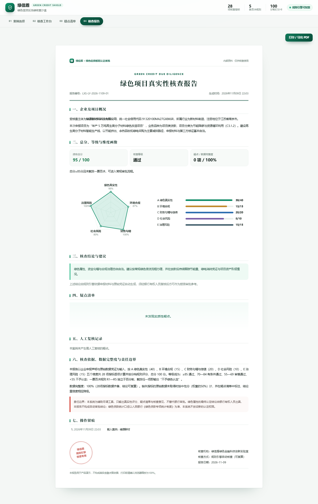
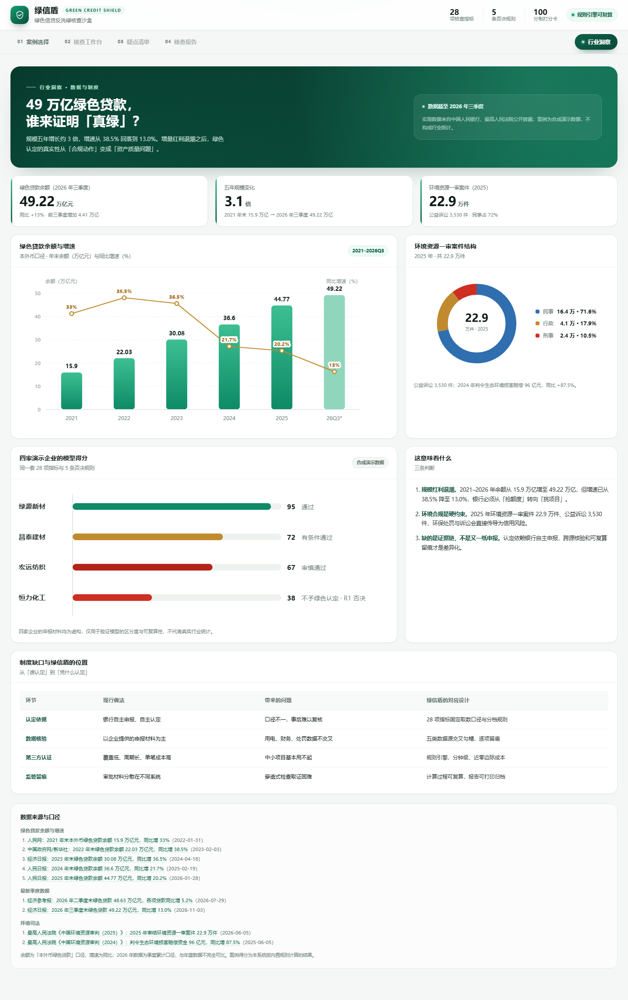

# 绿信盾 · 绿色信贷反洗绿核查沙盒

> **个人练习项目 / Personal practice project**
> 方向：金融科技 · 合规科技（RegTech）模拟练习
> 纯前端演示，4 家案例企业均为虚构，仅用于规则引擎与产品交互练习，不构成任何金融决策依据。

## 这是什么

一个可以离线打开的单页应用：把绿色信贷的「反洗绿」核查做成一套可复算的规则系统——
28 项打分指标 + 5 条一票否决，模拟从企业申报、材料核验、疑点清单到核查报告的完整流程。

不是审批系统，也不替代人工认定；它只回答一个问题：**这次绿色申报，是真是假？**

## 功能

- **案例核查**：4 个内置虚构案例（新材料、化工、建材、纺织）+ 全字段自定义录入
- **打分卡**：100 分制，A 绿色真实性 40 / B 环境合规 15 / C 财务勾稽 20 / D 社会风险 10 / E 治理风险 15
- **一票否决**：R1 无环评、R2 目录不符、R3 落地率过低、R4 未决重大环保诉讼、R5 实控人失信
- **疑点与复核**：逐条矛盾数据、分档依据、核查建议，支持人工复核留痕
- **核查报告**：可打印 / 导出 PDF，含五维雷达图与责任边界说明
- **行业洞察**：宏观公开数据（2021–2026Q3 绿色贷款余额与增速、2025 年环境资源案件）+ 合成案例区分度
- **主题**：亮色 / 暗色一键切换，默认跟随系统偏好

## 技术栈

纯 HTML + CSS + JavaScript，无构建步骤、无外部依赖、无后端，双击 `index.html` 即可运行。

数据全部在本地：

- `dataProvider.js` — 4 个内置案例与自定义模板
- `indicators.js` — 28 项指标、5 条否决规则、评分引擎
- `app.js` — 视图渲染、交互与报告生成
- `insights.js` — 行业洞察页的公开数据与来源

## 目录

```
.
├── index.html
├── app.js
├── dataProvider.js
├── indicators.js
├── insights.js
└── docs/
    ├── 01-cases.png
    ├── 02-workspace.png
    ├── 05-report.png
    └── 16-insights.png
```

## 截图






## 数据说明

- 宏观数据来自中国人民银行《金融机构贷款投向统计报告》、最高人民法院《中国环境资源审判》等公开披露，页面内逐条标注来源与日期。
- 4 家案例企业的名称、财务与用电数据均为**合成演示数据**，不代表任何真实企业，也不构成行业统计。
- 评分规则与分档阈值仅用于练习，不构成监管口径或银行授信标准。

## 用途

课程作业 / 个人作品集 / 规则引擎与前端交互练习。欢迎交流指正。
